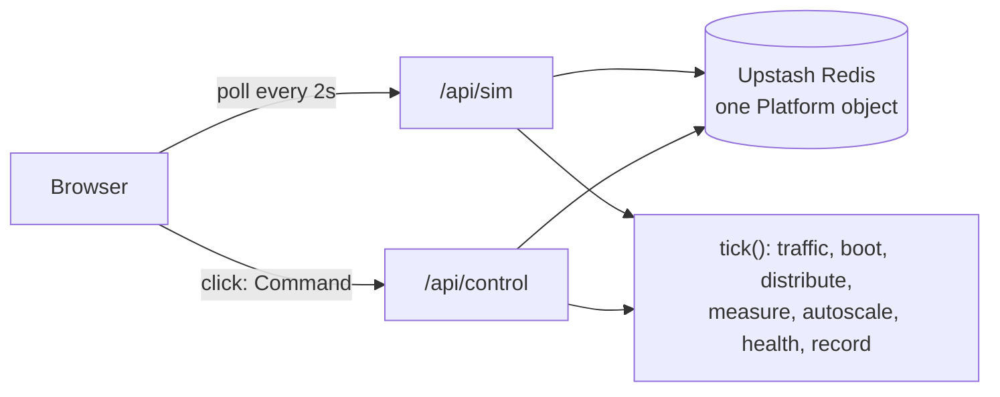

# Cloud Autoscale Simulator

**Push traffic at a web service and watch a cloud platform react: instances boot and join an
nginx upstream, errors spike and clear, and health alerts fire in red, yellow and green.**

A one-page, fully simulated autoscaling playground. Nothing real is started or sent
anywhere. It's built to be understood: every rule (the autoscaler, the traffic patterns,
the alert thresholds) lives in a small, commented TypeScript file.

**Live demo: https://cloud-autoscale-simulator.vercel.app**
(one shared world: everyone who opens it sees, and can change, the same simulation)


## What you can do

- **Control traffic**: slider, ±10/±100 buttons, Stop, and patterns: flat, spike, ramp,
  day/night wave, noise.
- **Watch it autoscale**: instances boot, join the pool, and drain when load drops, with
  utilisation, p95 latency, error rate and cost updating live.
- **See the nginx.conf** generated from the healthy instances, with added and removed
  `server` lines highlighted as they change.
- **Get notified like a real on-call**: one pop-up per health change (🟢 healthy, 🟡 under
  strain, 🔴 users see errors) with a distinct sound for each. Routine events stay in the
  event log.
- **Fast-forward time** (1x / 5x / 60x) and **share a link** to the exact view: the tab,
  service and log filter live in the URL.
- **Read the docs in the app**: one short page per tab at `/docs`.

| Overview | Docs |
|---|---|
|  |  |

## Try it in 30 seconds

1. Open the **Autoscaling Cluster** tab and press **Spike** (or set traffic to 400 req/s).
2. Utilisation jumps past 100% and errors appear: you get a 🔴 alert.
3. New instances boot, join `nginx.conf`, errors fall to 0%, and the alert turns 🟢.
4. Press **Stop traffic** and watch the extra instances drain one at a time.

## Status

| Area | State |
|---|---|
| Overview and Autoscaling Cluster tabs | Built |
| Autoscaler, traffic patterns, health status, notifications, docs | Built |
| Shared live state (Upstash Redis) and safe concurrent updates | Built |
| Load balancer algorithms (round-robin / least-conn / weighted) | **Setting only changes `nginx.conf`; traffic is still split evenly** |
| Deployments, Scheduled Scaling, Queue & Workers, Reliability (chaos and self-healing), Events & Alerts, Config tabs | Planned (shown as "soon" in the UI) |

## How it works



- **Tick-on-read.** Vercel has no background process, so time only moves when someone reads
  the world. Each poll works out how many seconds passed since the last one, runs that many
  `tick()` steps, and saves. One tick is one simulated minute.
- **One health status per service.** `ok`, `warning` or `critical`, with hysteresis (a
  different bar to enter a state than to leave it) so a metric hovering at a threshold
  can't flicker. A notification is written only when the status *changes*.
- **Autoscaler policy** ([`lib/engine/autoscaler.ts`](lib/engine/autoscaler.ts)). Above the
  scale-up threshold it adds enough instances to return to the middle of the band (at least
  +1, at most double). Below the scale-down threshold it removes one at a time, and only if
  the rest wouldn't be overloaded. A cooldown follows every action; min and max always apply.
- **No lost updates.** Many visitors share one Redis copy of the world. Saves are
  compare-and-set on a version number (a Lua script run atomically inside Redis), so a
  concurrent poll can never overwrite someone's click.
- **Free-tier friendly.** Polling is every 2s in production and pauses after 10 minutes
  without interaction; most polls are a single read.

## Tech stack

Next.js 15 (App Router) · React 19 · TypeScript · Tailwind CSS · shadcn/ui · Recharts ·
Sonner (toasts) · Upstash Redis · Vercel

## Run locally

```bash
npm install
npm run dev          # http://localhost:3000
```

No setup needed: locally the world is kept in memory. (Restarting the server resets it.)

## Deploy your own (free)

1. **Database.** Create a free Redis database at [console.upstash.com](https://console.upstash.com/redis).
   On its page, copy the **REST** URL and token (not the `redis://` string).
2. **Hosting.** Import this repo at [vercel.com/new](https://vercel.com/new) and add two
   environment variables (see [`.env.example`](.env.example)):

   | Name | Value |
   |---|---|
   | `UPSTASH_REDIS_REST_URL` | the REST URL |
   | `UPSTASH_REDIS_REST_TOKEN` | the REST token |

   Vercel's own Upstash integration names them `KV_REST_API_URL` / `KV_REST_API_TOKEN`;
   the app accepts either pair.
3. **Match the regions.** [`vercel.json`](vercel.json) pins the functions to Mumbai (`bom1`),
   next to the author's Upstash database. Change `regions` to the Vercel region nearest
   *your* database before deploying, or every request will cross an ocean to reach Redis
   (the default region is Washington DC, `iad1`).
4. **Check.** The header pill should read `storage: redis`. If it says `memory`, the
   variables didn't reach the deployment.

## Project structure

```
app/
  api/sim            GET: advance the world and return it (the poll target)
  api/control        POST: apply one validated Command
  docs/              the in-app documentation routes
components/
  tabs/              Overview, Cluster
  shared/            traffic controls, charts, instance table, event log, nginx view, config
  ui/                shadcn/ui primitives
hooks/               polling, URL-backed state, toasts, sound
lib/
  engine/            types, tick, autoscaler, traffic, metrics, nginx, commands
  store.ts           memory locally, Upstash in production (compare-and-set saves)
  docs.ts            the content of the in-app docs
```

If you want to read the code, start with [`lib/engine/types.ts`](lib/engine/types.ts), then
[`tick.ts`](lib/engine/tick.ts), then [`autoscaler.ts`](lib/engine/autoscaler.ts).

## Scripts

| Command | What it does |
|---|---|
| `npm run dev` | Dev server |
| `npm run build` / `npm start` | Production build and server |
| `npm run lint` | ESLint |

## Good to know

- **Everything is simulated.** The "instances", "nginx" and "traffic" are numbers in a
  TypeScript model. The app never sends real requests to any site.
- **The demo is public and has no logins.** Anyone with the link can change traffic or
  press Reset.
- **Free tiers have limits.** Check the current Upstash and Vercel free-plan quotas. The app
  is built to use few requests (see "How it works"), but a busy public link can still
  exceed a free quota.
